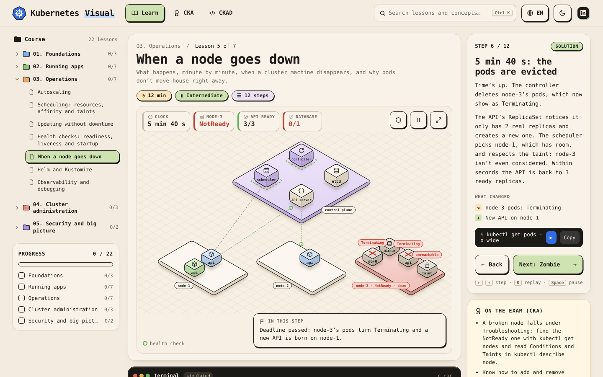

# Kubernetes Visual

[🇧🇷 Português](README.pt-BR.md) · 🇺🇸 English

A free, visual and interactive Kubernetes course in **English and Brazilian Portuguese**. Each concept is an animated isometric diagram you step through, with a simulated `kubectl` terminal and study tracks for the **CKA**, **CKAD** and **CKS** exams.

**Live:** https://andrentfs.github.io/kubernetes-visual/



## What's inside

- **27 lessons, 288 steps** in 6 modules: fundamentals, running apps, operations, cluster administration, security, advanced security (CKS). Content targets **Kubernetes v1.37**, the CKA/CKAD exam version on 27 Nov 2026 (the CKS curriculum is also v1.37) ([`data/meta.js`](data/meta.js)).
- **Animated diagrams:** controllers creating pods, packets flowing through Services, nodes failing, probes, rollouts…
- **Simulated terminal** in 10 lessons: `kubectl get/describe/logs/exec/scale/rollout…`, outputs derived from the diagram of each step. It's a deterministic simulation, not a real cluster.
- **KCNA and KCSA mock exams:** 30 original questions each, weighted by the official curriculum, with timer, review and docs links.
- **Node failure simulator:** take nodes down, go back in time, change the timings ([ADR-004](docs/adr/ADR-004-simulation-engine.md)).
- **CKA, CKAD and CKS pages:** official domains and weights ([`cncf/curriculum`](https://github.com/cncf/curriculum) v1.37), competency → lesson mapping, checklist and exam tips.

## Development (Docker)

Development is Docker-first ([ADR-001](docs/adr/ADR-001-docker-first.md)). You only need Docker (and `make`).

```bash
make up          # site at http://localhost:8082 — serves the folder: edit and reload
make test        # unit tests + PT/EN parity + end-to-end (Playwright/Chromium)
make shell       # shell inside the dev container
make preview     # production-like image at http://localhost:8081
make lighthouse  # Lighthouse (mobile + desktop) into docs/lighthouse/
make pages       # regenerate the per-lesson static pages and the sitemap
make manifests   # validate the lessons' YAML with kubeconform (also runs in CI)
make down        # stop everything
```

**Windows without `make`:**

```powershell
docker compose up site                                    # http://localhost:8082
docker compose --profile dev run --rm dev npm test        # tests
docker compose --profile preview up --build preview       # http://localhost:8081
```

The site also opens straight from disk (`index.html`), no server needed.

## Project layout

| Path | Content |
|---|---|
| `index.html` | Page structure and script order |
| `css/app.css` | Styles |
| `data/` | `scenes.js` (diagrams per step), `certs.js` (CKA/CKAD/CKS), `meta.js` (reference version) |
| `i18n/` | `pt.js`, `en.js` (texts, only the active language is loaded), `labels.js` (diagram labels) |
| `licao/`, `en/lesson/` | Static page per lesson, generated by `scripts/gen-lesson-pages.mjs` ([ADR-005](docs/adr/ADR-005-lesson-pages.md)) |
| `js/` | `geometry.js`, `content.js`, `renderer.js`, `ui.js` (engine and UI) |
| `js/quiz/`, `data/quiz/` | KCNA and KCSA mock exams, loaded on demand |
| `js/sim/` | Simulators, loaded on demand: `engine.js` (clock), `nodefail.js` (model), `ui.js` (screen) |
| `js/term/` | Simulated terminal: `lessons.js` (data), `files.js` (example YAML), `engine.js` (interpreter) |
| `tests/` | `unit/`, `e2e/`, `tools/` |

## Documentation

- [Architecture](docs/ARCHITECTURE.md) · [ADRs](docs/adr/) · [Implementation plan (PT)](docs/IMPLEMENTATION_PLAN.md) · [Roadmap](ROADMAP.md) · [Changelog](CHANGELOG.md)
- [Adding a lesson](docs/guides/NEW_LESSON.md) · [Diagrams and animations](docs/guides/ANIMATIONS.md)
- [Contributing](CONTRIBUTING.md) · [Code of Conduct](CODE_OF_CONDUCT.md) · [Security](SECURITY.md)
- [Lighthouse measurements](docs/lighthouse/README.md)

## License

Code under [MIT](LICENSE). Educational content (texts, scenes, examples and images) under [CC BY 4.0](LICENSE-CONTENT.md).
Kubernetes® is a registered trademark of The Linux Foundation. This project is independent and not affiliated with the CNCF or The Linux Foundation.
