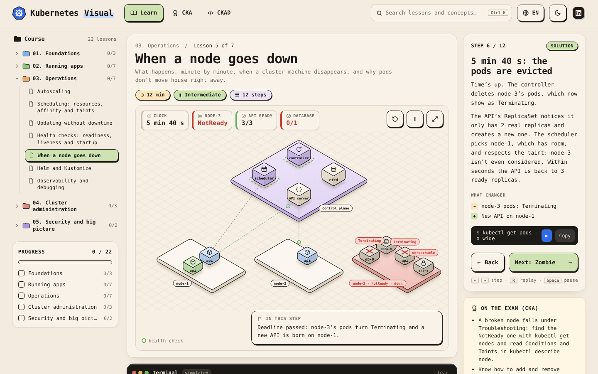

# Kubernetes Visual

🇧🇷 Português · [🇺🇸 English](README.md)

Curso interativo e visual sobre Kubernetes, em português (Brasil) e inglês. Cada conceito é um diagrama isométrico animado que você avança passo a passo, com terminal `kubectl` simulado e trilhas para as provas CKA, CKAD e CKS.

**No ar:** https://andrentfs.github.io/kubernetes-visual/



## Desenvolvimento (Docker)

O desenvolvimento é orientado a Docker ([ADR-001](docs/adr/ADR-001-docker-first.md)): só é preciso ter Docker e `make`.

```bash
make up        # site em http://localhost:8082 — lê os arquivos da pasta: edite e recarregue
make test      # testes unitários + paridade PT/EN + E2E (Playwright/Chromium)
make shell     # terminal dentro do container de desenvolvimento
make preview   # imagem fechada, igual ao que vai publicado, em http://localhost:8081
make down      # para tudo
```

**No Windows** (sem `make`), use os comandos do Docker Compose diretamente:

```powershell
docker compose up site                                    # http://localhost:8082
docker compose --profile dev run --rm dev npm test        # testes
docker compose --profile preview up --build preview       # http://localhost:8081
```

Também dá para rodar só uma parte: `make test-unit`, `make test-i18n`, `make test-e2e`. `make pages` regera as páginas estáticas por lição e o sitemap. `make manifests` valida os YAMLs das lições com o kubeconform (também roda no CI).
Se mudar o `package.json`, rode `make clean` para recriar o volume de `node_modules`.

| Container | Imagem | Uso |
|---|---|---|
| `site` | `nginx:1.27-alpine` | Serve a pasta sem cache (desenvolvimento) |
| `dev` | `docker/Dockerfile.dev` (base `mcr.microsoft.com/playwright:v1.63.0-noble`) | Testes e ferramentas |
| `preview` | `Dockerfile` (nginx + arquivos do site) | Conferir antes de publicar |

### Testes

| Suíte | Onde | O que verifica |
|---|---|---|
| Unitários | `tests/unit/` (`node:test`) | Motor do terminal simulado; dados de certificação; SEO; cenas × textos; páginas por lição atualizadas; checagem rápida dos YAMLs |
| Manifestos (CI) | `tests/tools/extract-manifests.mjs` + kubeconform | Os 28 YAMLs de exemplo contra o schema da versão de referência ([ADR-006](docs/adr/ADR-006-kubeconform.md)) |
| Links (CI) | lychee | Links dos documentos `.md` |
| Paridade PT/EN | `tests/tools/i18n-parity.mjs` | Mesmas chaves, lições, passos, campos e legendas nos dois idiomas |
| E2E | `tests/e2e/` (Playwright) | Todos os passos nos dois idiomas sem erro e sem seta atravessando bloco; terminal; abas CKA/CKAD/CKS; idioma; teclado; layout desktop e celular |

## Estrutura

| Caminho | Conteúdo |
|---|---|
| `index.html` | Estrutura da página e ordem de carregamento dos scripts |
| `css/app.css` | Estilos |
| `data/scenes.js` | Cenas de cada lição (iguais nos dois idiomas) |
| `data/certs.js` | Domínios e competências CKA/CKAD/CKS |
| `i18n/pt.js`, `i18n/en.js` | Textos (só o idioma em uso é baixado) |
| `i18n/labels.js` | Rótulos dos diagramas, nos dois idiomas ([ADR-003](docs/adr/ADR-003-lazy-language.md)) |
| `licao/`, `en/lesson/` | Páginas estáticas por lição, geradas por `scripts/gen-lesson-pages.mjs` ([ADR-005](docs/adr/ADR-005-lesson-pages.md)) |
| `js/geometry.js` · `content.js` · `renderer.js` · `ui.js` | Motor isométrico e interface ([ADR-002](docs/adr/ADR-002-file-structure.md)) |
| `js/term/` | Terminal `kubectl` simulado: `lessons.js` (dados por lição), `files.js` (YAMLs), `engine.js` (interpretador) |

O site também abre direto do disco (`index.html`), sem servidor.

## Publicação

O GitHub Pages publica a raiz da branch `main`. O site é estático e não tem etapa de build. `package.json`, `tests/`, `docker/` e `Makefile` são só para desenvolvimento.

## Documentação

- [Arquitetura](docs/ARCHITECTURE.md) · [ADRs](docs/adr/) · [Plano de implementação](docs/IMPLEMENTATION_PLAN.md) · [Roadmap](ROADMAP.md) · [Changelog](CHANGELOG.md)
- [Como criar uma lição](docs/guides/NEW_LESSON.md) · [Como fazer diagramas e animações](docs/guides/ANIMATIONS.md)
- [Como contribuir](CONTRIBUTING.md) · [Código de conduta](CODE_OF_CONDUCT.md) · [Segurança](SECURITY.md)
- [Medições do Lighthouse](docs/lighthouse/README.md)

## Licença

Código sob [MIT](LICENSE). Conteúdo didático (textos, cenas, exemplos e imagens) sob [CC BY 4.0](LICENSE-CONTENT.md).
Kubernetes® é marca registrada da The Linux Foundation; este projeto é independente e não tem vínculo com a CNCF nem com a Linux Foundation.
